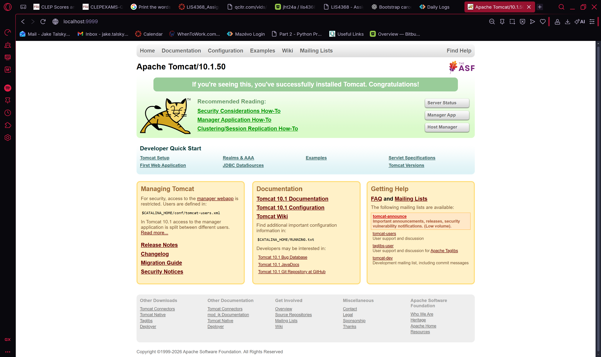
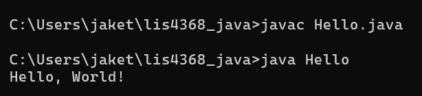
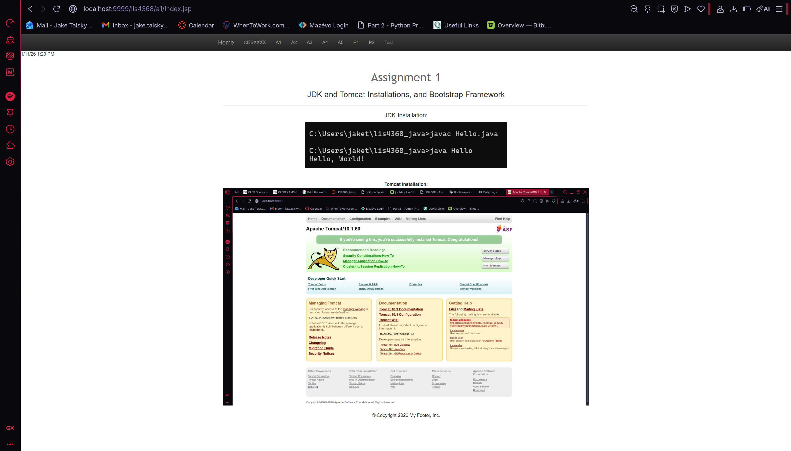

> **NOTE:** This README.md file should be placed at the **root of each subdirectory--e.g., a1, a2, etc.**
>
>Also, this file **must** use Markdown syntax, and provide project documentation as per below--otherwise, points **will** be deducted.
>

# Course Title

## Your Name

### Assignment # Requirements:

*Sub-Heading:*

1. Distributed Version Control with Git and Bitbucket
2. Java/JSP/Servlet Development Installation
3. Chapter Questions (Chs 1 - 4)

#### README.md file should include the following items:

* Screenshot of running java Hello (#1 above);
* Screenshot of running http://localhost:9999 (#2 above, Step #4(b) in tutorial);
* git commands w/short descriptions;
* Bitbucket repo links: a) this assignment and b) the completed tutorial above (bitbucketstationlocations).

> This is a blockquote.
> 
> This is the second paragraph in the blockquote.
>
> #### Git commands w/short descriptions:

1. git init - Creates a new git repository in the current folder
2. git status - Displays the current state of the repository (staged, modified, or untracked)
3. git add - Stages changes to be included in the next commit
4. git commit - Records staged charges into the repository with a message which describes the changes
5. git push - Sends the local commits to a remote repository (Bitbucket)
6. git pull - Fetches changes from a remote repository and merges them into the local branch
7. git rm - Removes a file from the working directory and stages the removal for the next commit

#### Assignment Screenshots (Note: **BE SURE** to modify for specific course!):

*Screenshot of AMPPS running http://localhost*:

*Screenshot of running java Hello*:

*Screenshot of a1/index.jsp*

