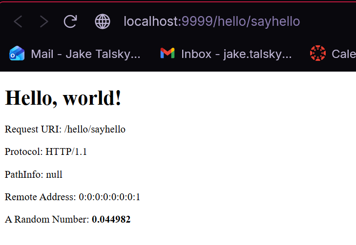
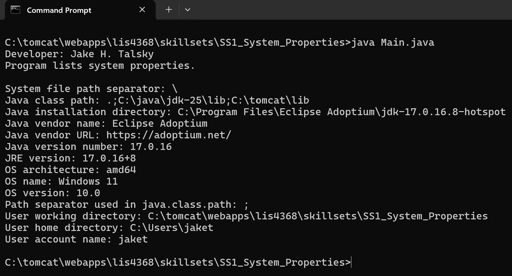
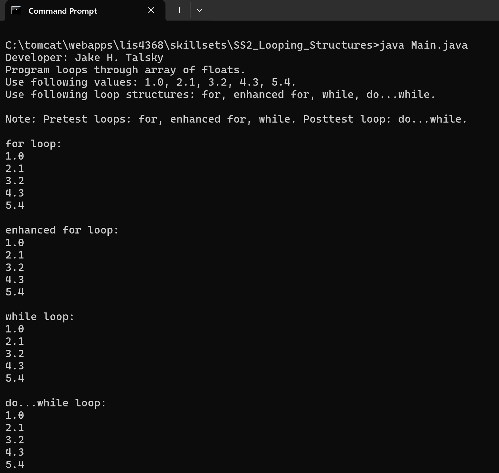
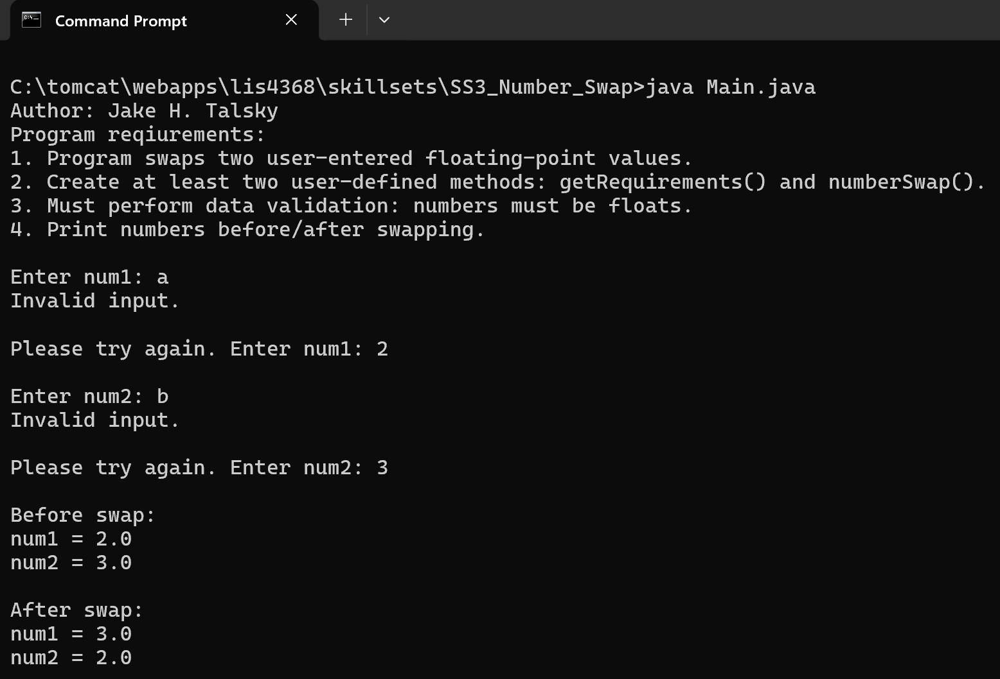

> **NOTE:** This README.md file should be placed at the **root of each subdirectory--e.g., a1, a2, etc.**
>
>Also, this file **must** use Markdown syntax, and provide project documentation as per below--otherwise, points **will** be deducted.
>

# LIS4368

## Jake Talsky

### Assignment 2 Requirements:

1. Development Environment through AMPPS
2. Create a Database Servlet using @WebServlet, inclusive
3. Set and confirm environment variable paths
4. Properly display assessment links through http://localhost:9999/
5. Chapter 5 and 6 Questions

#### README.md file should include the following items:

* [http://localhost:9999/hello](http://localhost:9999/hello)
* [http://localhost:9999/hello/HelloHome.html](http://localhost:9999/hello/index.html)
* [http://localhost:9999/hello/sayhello](http://localhost:9999/hello/sayhello)
* [http://localhost:9999/hello/querybook.html](http://localhost:9999/hello/querbook.html)

#### Assignment Screenshots (Note: **BE SURE** to modify for specific course!):

http://localhost:9999/hello/index.html

http://localhost:9999/hello/index.html

http://localhost:9999/hello/querybook.html (selected item)

Query Results

*Java Skill Set's Screenshots*

| [Skillset 1: System Properties](../skillsets/SS1_System_Properties) | [Skillset 2: Looping Structures](skillsets/SS2_Looping_Structures) | [Skillset 3: Number Swap](../skillsets/SS3_Number_Swap) |
| ------------------------------ | ------------------------------ | ------------------------------ |
|  |  |  |
