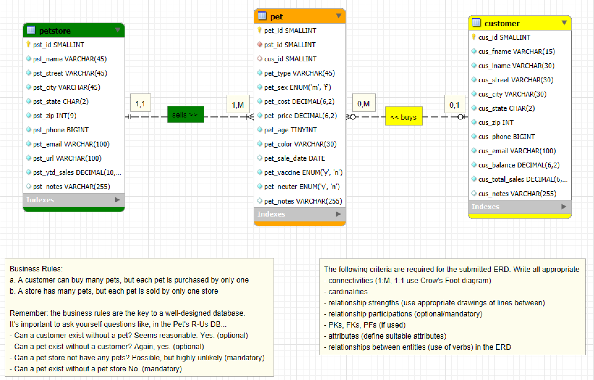
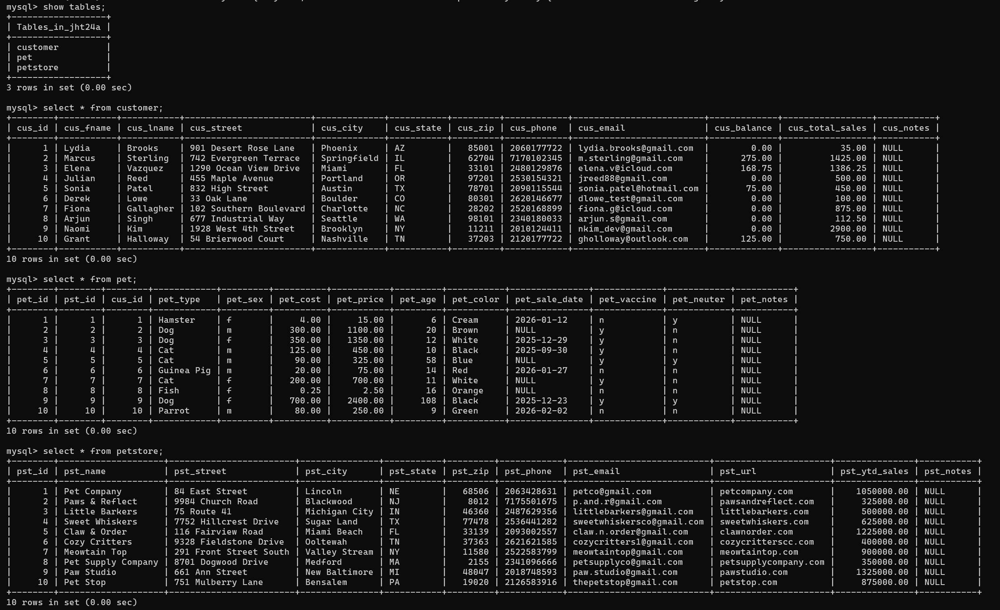

> **NOTE:** This README.md file should be placed at the **root of each subdirectory--e.g., a1, a2, etc.**
>
>Also, this file **must** use Markdown syntax, and provide project documentation as per below--otherwise, points **will** be deducted.
>

# LIS4368 - Advanced Web Application Development

## Jake H. Talsky

### Assignment 3 Requirements:

*Deliverables:*

1. Entity Relationship Diagram (ERD)
2. Include data (at least 10 records in each table)
3. Provide Bitbucket read-only access to a3 repo (Language SQL), must include README.md, using Markdown syntax, and include links to all of the following files (from README.md):
    * docs folder: a3.mwb, and a3.sql
    * img folder: a3.png (export a3.mwb file as a3.png)
    * README.md (must display a3.png ERD)
4. Blackboard Links: a3 Bitbucket rep
#### README.md file should include the following items:

* Screenshot of A3 ERD that links to the image

> This is a blockquote.
> 
> This is the second paragraph in the blockquote.

#### Assignment Screenshots (Note: **BE SURE** to modify for specific course!):

*1. Screenshot of ERD*

*2. Screenshot of populated tables*

*3. A3 MWB File*

[3. A3 MWB File](docs/a3.mwb)

*4. A3 SQL File*

[4. A3 SQL File](docs/a3.sql)