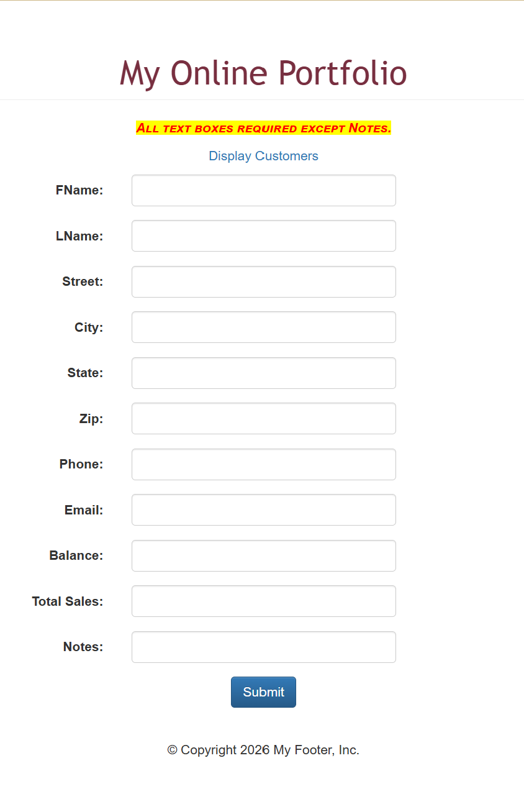
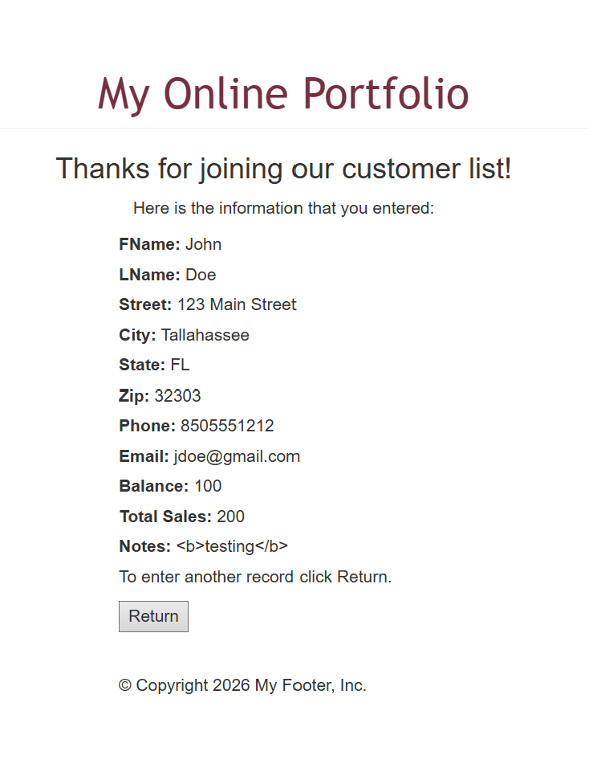
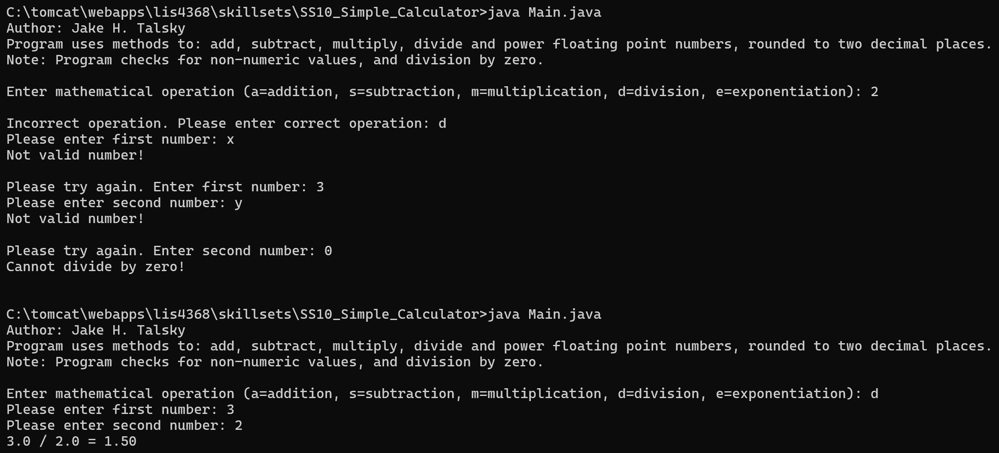
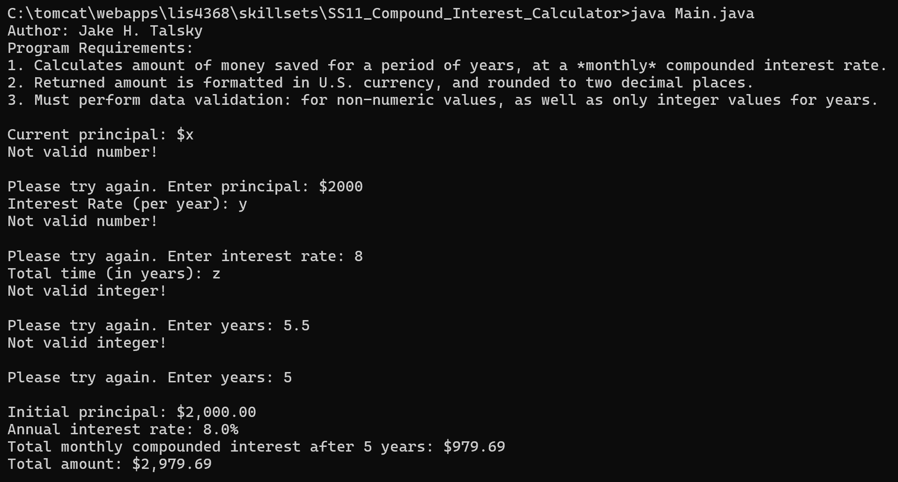
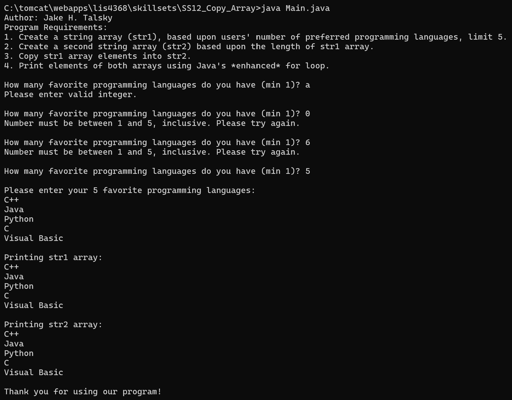

> **NOTE:** This README.md file should be placed at the **root of each subdirectory--e.g., a1, a2, etc.**
>
>Also, this file **must** use Markdown syntax, and provide project documentation as per below--otherwise, points **will** be deducted.
>

# LIS4368 - Advanced Web Application Development

## Jake H. Talsky

### Assignment 4 Requirements:

*Deliverables:*

1. Add server-side validation (and regular expressions) - as per the entity attribute requirements
2. Provide Bitbucket read-only access to a4 repo, must include README.md, using Markdown syntax
3. Skillsets 10-12
4. Chapter 11 and 12 questions

#### README.md file should include the following items:

* Screenshot of failed server-side validation
* Screenshot of passed server-side validation

#### Assignment Screenshots (Note: **BE SURE** to modify for specific course!):

*Failed Validation*

*Passed Validation*

#### Java Skill Set's Screenshots

| [Skillset 10: Simple Calculator](../skillsets/SS10_Simple_Calculator) | [Skillset 11: Compound Interest Calculator](../skillsets/SS11_Compound_Interest_Calculator) | [Skillset 12: Copy Array](../skillsets/SS12_Copy_Array) |
| ------------------------------ | ------------------------------ | ------------------------------ |
|  |  |  |