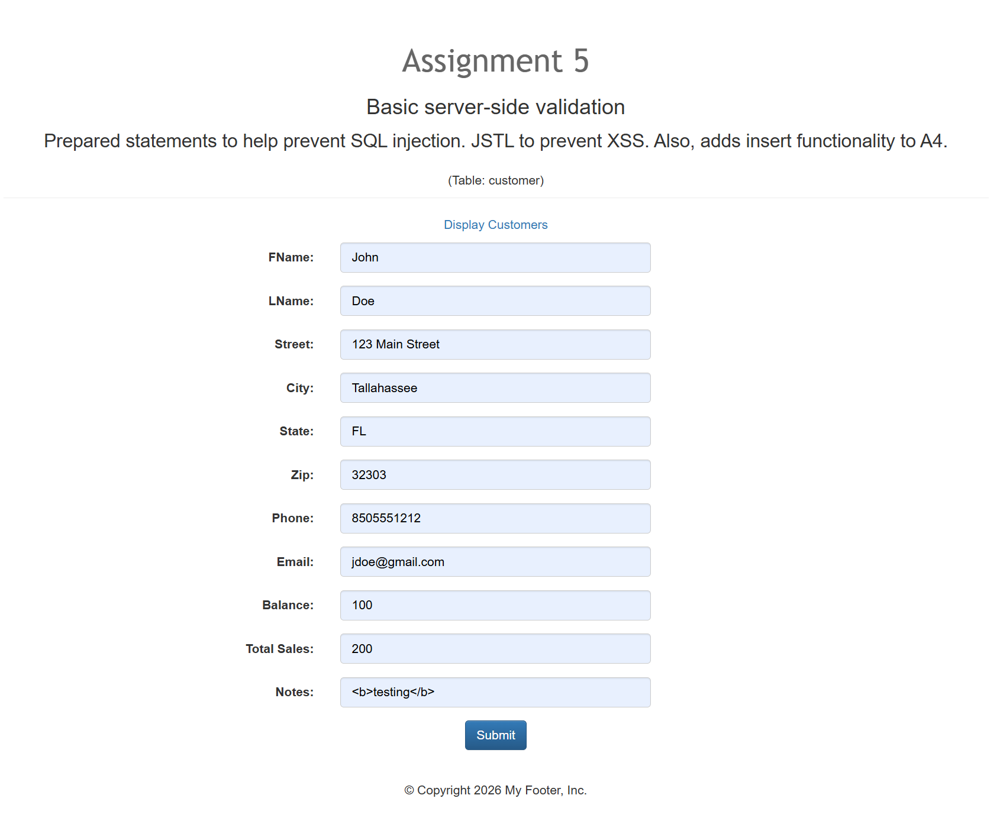
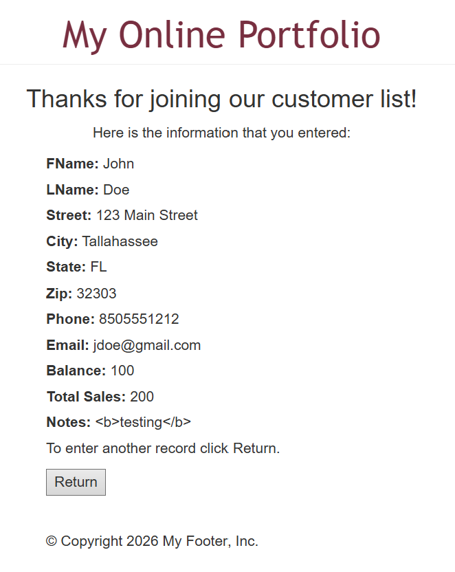
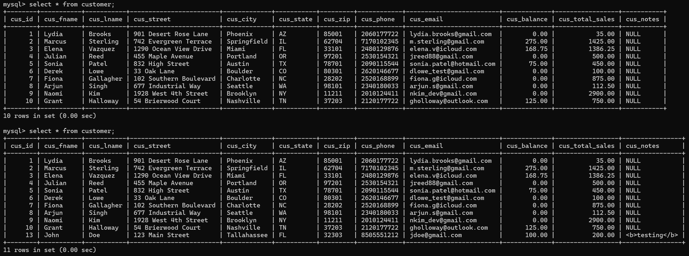
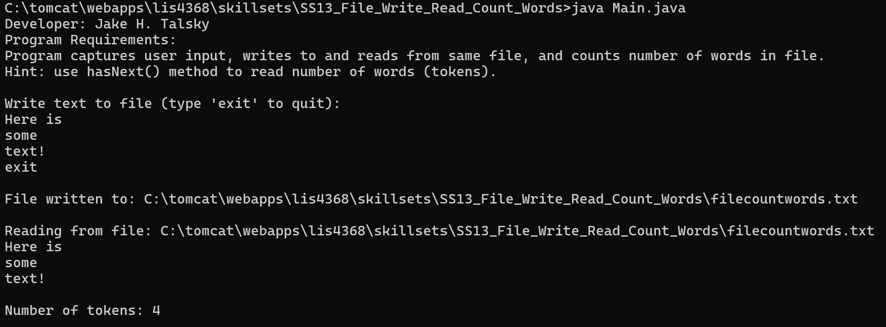
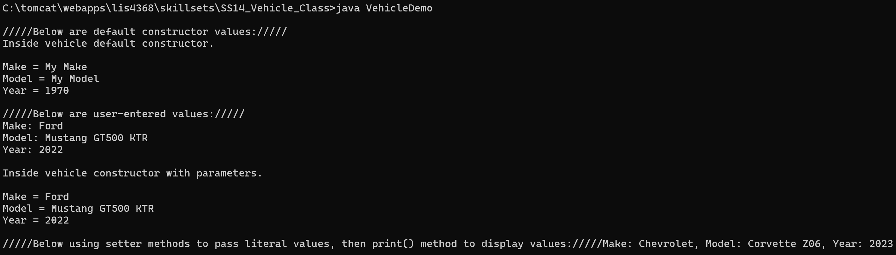
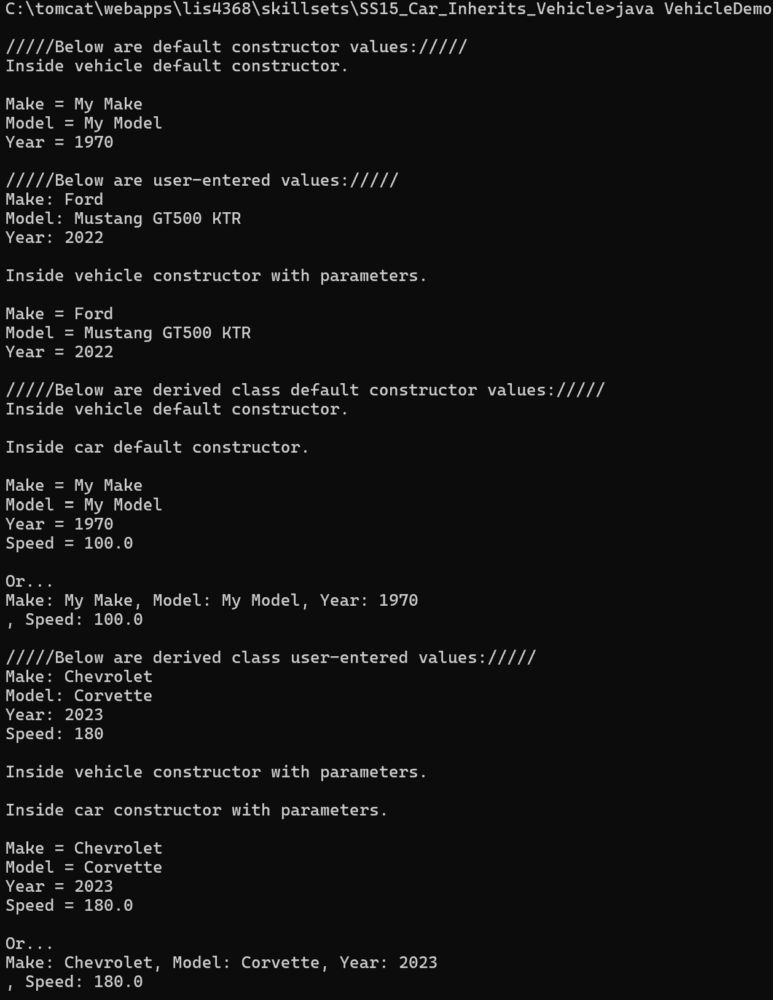

> **NOTE:** This README.md file should be placed at the **root of each subdirectory--e.g., a1, a2, etc.**
>
>Also, this file **must** use Markdown syntax, and provide project documentation as per below--otherwise, points **will** be deducted.
>

# LIS4368 - Advanced Web Application Development

## Jake H. Talsky

### Assignment 4 Requirements:

*Deliverables:*

1. Include server-side validation
2. Add insert functionality for customerform.jsp
3. Provide Bitbucket read-only access to a4 repo, must include README.md, using Markdown syntax
4. Skillsets 13-15
5. Chapter 13, 14, and 15 questions

#### README.md file should include the following items:

* Screenshot of failed server-side validation
* Screenshot of passed server-side validation
* Screenshot of SQL data entry (in terminal)

#### Assignment Screenshots (Note: **BE SURE** to modify for specific course!):

*Valid User Entry*

*Passed Validation*

*Database Entry*

#### Java Skill Set's Screenshots

| [Skillset 13: File Write Read Count Words](../skillsets/SS13_File_Write_Read_Count_Words) | [Skillset 14: Vehicle Class](../skillsets/SS14_Vehicle_Class) | [Skillset 15: Car Inherits Vehicle](../skillsets/SS15_Car_Inherits_Vehicle) |
| ------------------------------ | ------------------------------ | ------------------------------ |
|  |  |  |