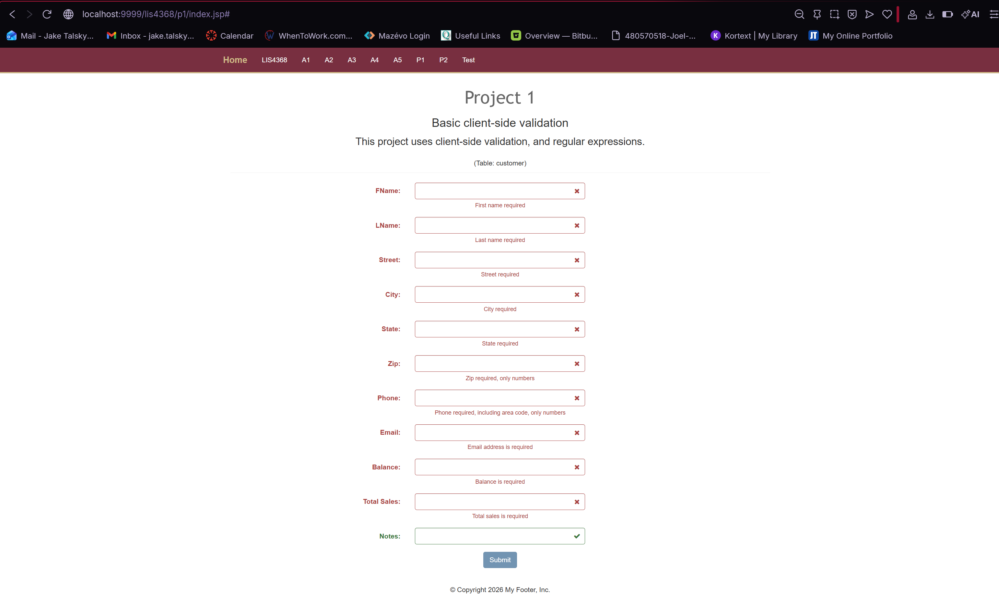
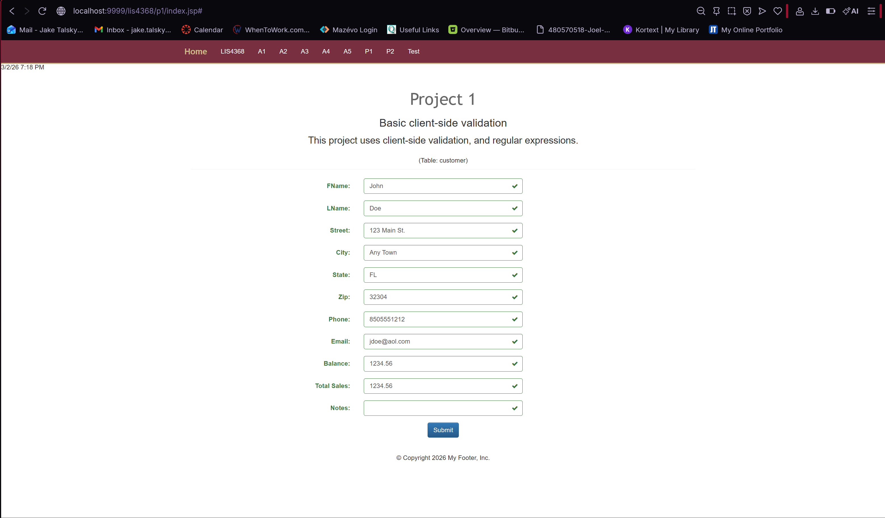

> **NOTE:** This README.md file should be placed at the **root of each subdirectory--e.g., a1, a2, etc.**
>
>Also, this file **must** use Markdown syntax, and provide project documentation as per below--otherwise, points **will** be deducted.
>

# LIS4368 - Advanced Web Application Development

## Jake H. Talsky

### Project 1 Requirements:

*Deliverables:*

1. Add jQuery validation and regular expressions - as per the entity attribute requirements
2. Provide Bitbucket read-only access to p1 repo, must include README.md, using Markdown syntax
3. Chapter 9 and 10 questions

#### README.md file should include the following items:

* Screenshot of failed client-side validation
* Screenshot of passed client-side validation

#### Assignment Screenshots (Note: **BE SURE** to modify for specific course!):

*Failed Validation*

*Passed Validation*

