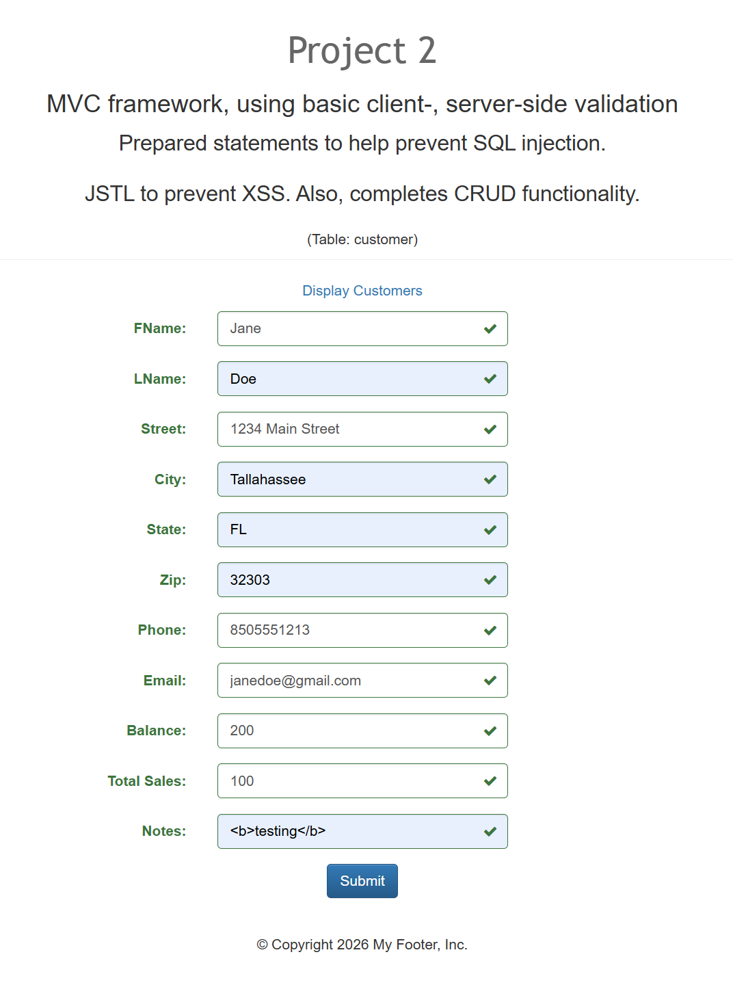
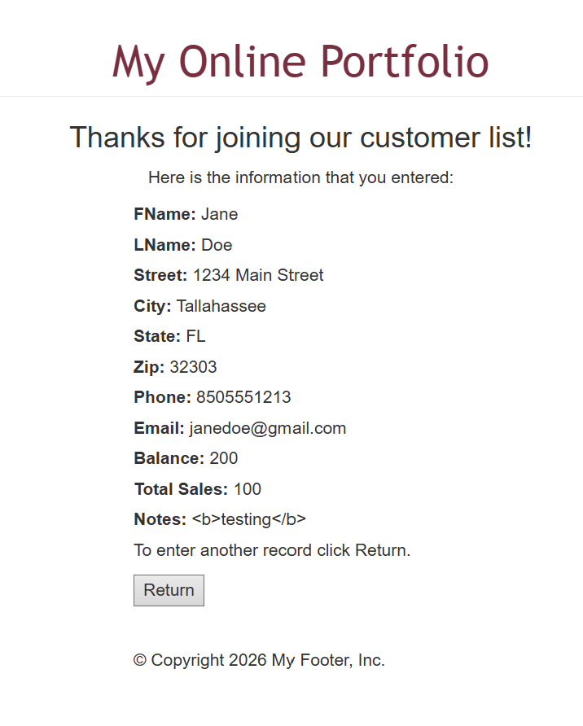
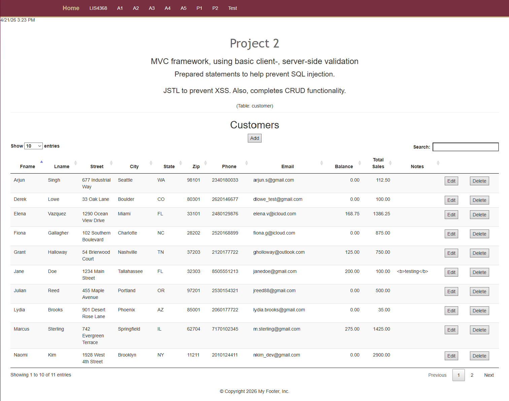
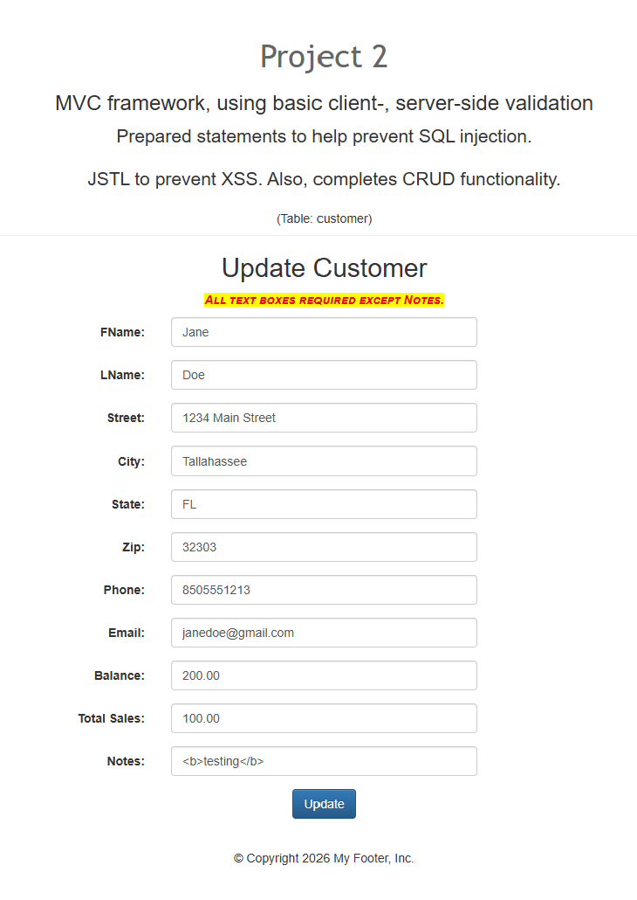
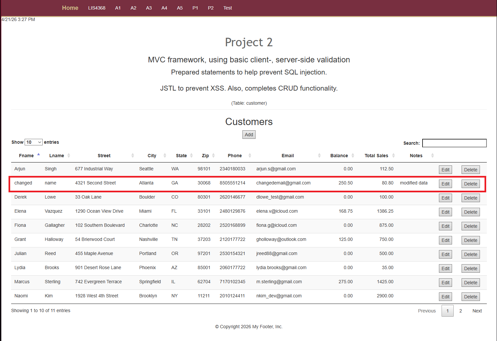
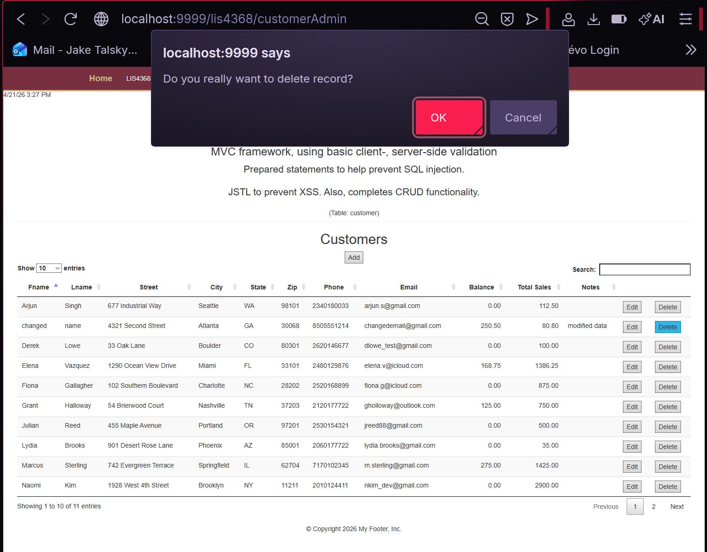
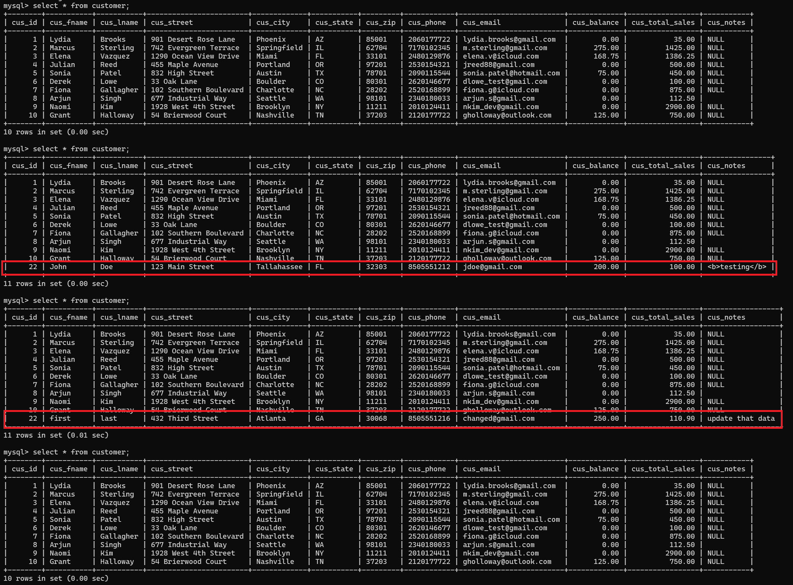
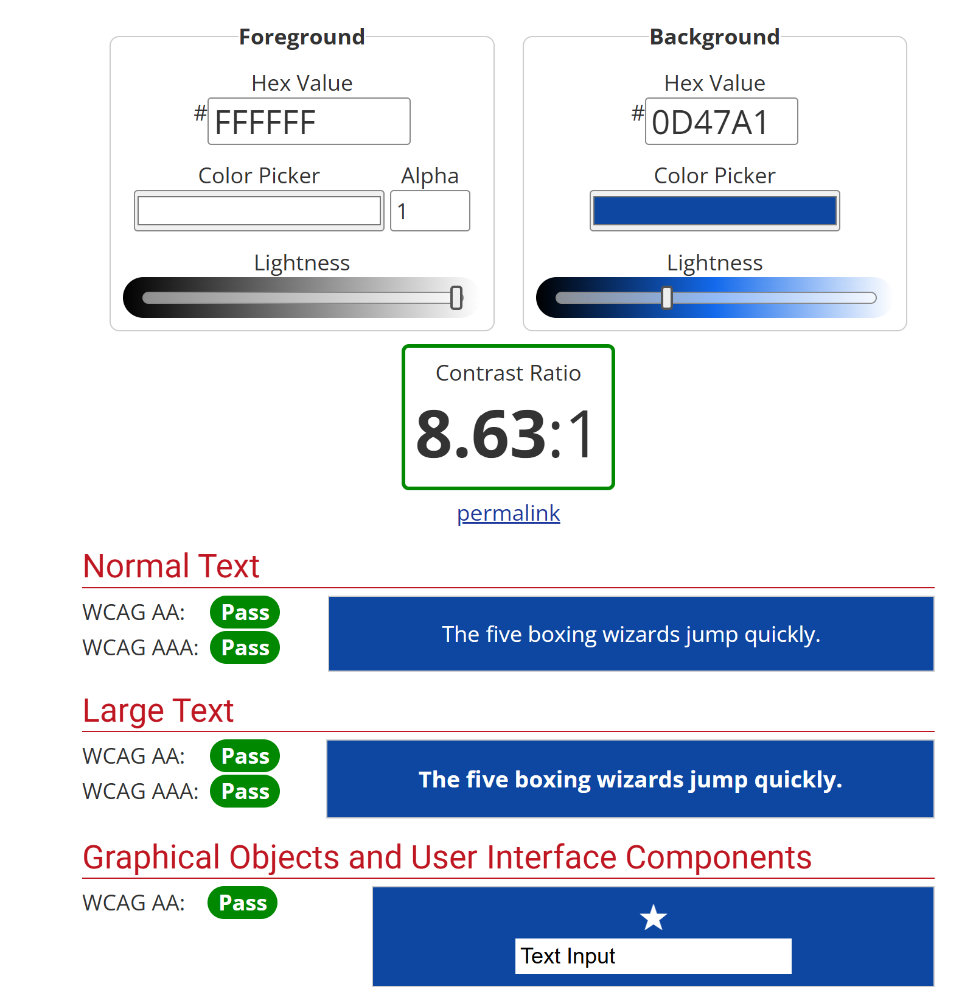

> **NOTE:** This README.md file should be placed at the **root of each subdirectory--e.g., a1, a2, etc.**
>
>Also, this file **must** use Markdown syntax, and provide project documentation as per below--otherwise, points **will** be deducted.
>

# LIS4368 - Advanced Web Application Development

## Jake H. Talsky

### Project 2 Requirements:

*Deliverables:*

1. Include client- and server-side validation
2. Add SQL connection through website
3. Provide Bitbucket read-only access to p1 repo, must include README.md, using Markdown syntax
4. Chapter 16 and 17 questions

#### README.md file should include the following items:

* Screenshot of Valid User Form Entry
* Screenshot of Passed Validation
* Screenshot of Display Data
* Screenshot of Modify Form
* Screenshot of Modified Data
* Screenshot of Delete Warning
* Screenshot of Associated Database Changes
* Screenshot of Logo Contrast Checker

#### Assignment Screenshots (Note: **BE SURE** to modify for specific course!):

**Valid User Form Entry**

**Passed Validation**

**Display Data**

**Modify Form**

**Modified Data**

**Delete Warning**

**Associated Database Changes (Select, Insert, Update, Delete)**

**Constrast Checker**

